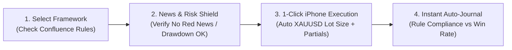

# 01. Market & Competitor Analysis

## 1. Why Target Gold (`XAUUSD`) & Prop-Firm Traders First?

1. **Massive Willingness to Pay:** Over 2 million retail traders buy Prop Firm challenges (`FTMO`, `FundingPips`, `The5ers`, `Topstep`, `Maven`) costing \$100 to \$1,000+ per evaluation. Saving **one** \$100k challenge from a daily drawdown violation pays for a full year of your SaaS subscription.
2. **Gold (`XAUUSD`) is the #1 Traded Prop Instrument:** Over 60% of CFD prop-firm volume is on `XAUUSD`. Yet Gold has the most punishing contract math, wildest session volatility, and strictest news-trading bans.
3. **Mobile Execution Dominance:** More than 70% of retail Gold traders execute or manage their trades from an **iPhone** (`MT5 iOS`, `cTrader iOS`, `TradeLocker`), where calculating exact lot sizes and checking rules is currently painful and error-prone.

---

## 2. Competitor Matrix

| Competitor | Category | Pricing | Strengths | Fatal Flaws (Where We Beat Them) |
| :--- | :--- | :--- | :--- | :--- |
| **TradeZella** | Post-Trade Journal & Playbook SaaS | \$29 – \$49/mo | Polished UI, good backtesting & post-trade analytics. | **100% passive & backward-looking.** Cannot place trades, cannot block bad trades, weak mobile execution workflow, clunky Gold/MT5 pip math. |
| **Magic Keys** | Execution Keypad & Lot Calculator | \$69 – \$199 | Fast lot calculation, auto-breakeven & partials on MT4/MT5/cTrader. | **Desktop-bound or clunky.** No strategy checklist gatekeeper, no journaling analytics, no iPhone-native discipline workflow. |
| **TraderSync / Edgewonk** | Trading Journals | \$15 – \$79/mo | Deep statistical tagging and AI summaries. | Requires manual post-trade data entry/tagging. Traders quit journaling after losing streaks. |
| **MQL5 Trade Manager EAs** | MetaTrader Chart Plugins | \$50 – \$150 | Direct on-chart execution inside desktop MT4/MT5. | Looks like 1998 software, requires a 24/7 Windows VPS, **does not work on iPhone MT5**, zero cloud analytics. |
| **FinancialJuice / ForexFactory** | News & Economic Calendars | Free – \$99/mo | Fast macro headlines and Red-Folder event schedules. | Disconnected from execution. Knowing CPI is at 8:30 AM doesn't stop an emotional trader from clicking Buy at 8:28 AM. |

---

## 3. Our Positioning: The Category King of "Pre-Trade Execution & Discipline"

Instead of competing as "another trading journal" or "another charting app," we position as an **Active Execution Co-Pilot & Prop Account Protector**:

### Why Traders Switch to Us:
* **Replaces 3 Subscriptions:** Replaces *Magic Keys* (lot sizing/execution) + *TradeZella* (journaling/playbooks) + *ForexFactory alerts* (news protection) in a single iPhone-first app.
* **Works on iPhone Anywhere:** Desktop EAs don't work on iOS MetaTrader. Because our app connects via Cloud Broker APIs (or acts as an instant companion calculator + journal), traders get institutional-grade risk management right on their iPhone.

---

## 4. Monetization & Pricing Strategy

### Tier 1: Free Forever ("The Gold Calculator Lead Magnet")
* Instant `XAUUSD` / Forex / Indices Lot Size & Pip Value Calculator.
* Live Gold Session Clock (Asian / London / NY Killzones) + Red-Folder USD News Countdown.
* 1 Configurable Strategy Framework + Paper Trading / Manual Execution Mode (up to 15 logged trades/month).

### Tier 2: Pro Trader — \$39/month (\$29/mo billed annually)
* Unlimited Configurable Trading Frameworks & Custom Checklists.
* Automated Pre-Trade Gatekeeper ("Unlock-to-Trade") + Tilt/Drawdown Lockout Shield.
* Full Auto-Journal & Behavioral Analytics (*Win Rate by Framework Compliance*, *Session Expectancy*, *Cost of Broken Rules*).
* 1 Connected Broker / Prop Firm Account (MT4/MT5/cTrader/TradeLocker Cloud Sync).

### Tier 3: Prop Funded Master — \$69/month (\$49/mo billed annually)
* Multi-Account Prop Firm Manager (up to 5 accounts with Built-in Trade Copier & Prop Firm Rule Presets for FTMO, FundingPips, The5ers, etc.).
* Automated Cloud Hard-Stop (Auto-flattens open trades 3 minutes before Red-Folder USD News or if Daily Drawdown hits buffer limit).
* Weekly AI Performance & Leakage Audit.

---

## 5. Go-To-Market (GTM) & Distribution Channels

1. **Viral iPhone Reels / TikToks / Shorts:** Show the visceral difference between placing a messy trade on MT5 vs. sliding through a sleek iPhone checklist that blocks a trade before CPI news and calculates exact Gold lots in 1 second.
2. **Prop Firm Affiliate & Discord Communities:** Partner with Gold/SMC trading communities (`ICT`, `SMC`, `XAUUSD` signal/education groups). Allow educators to **share their pre-built Framework Templates via a link** (e.g., *"Import Mentor's Gold NY Sweep Framework"*). Every student must install your app to use their mentor's interactive framework!
3. **Prop Firm B2B White-Label:** Sell the Risk/Discipline dashboard directly to Prop Firms as a value-add addon during checkout ("Add Account Protection Shield for \$19").
