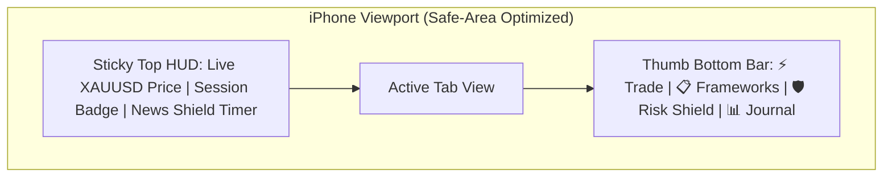
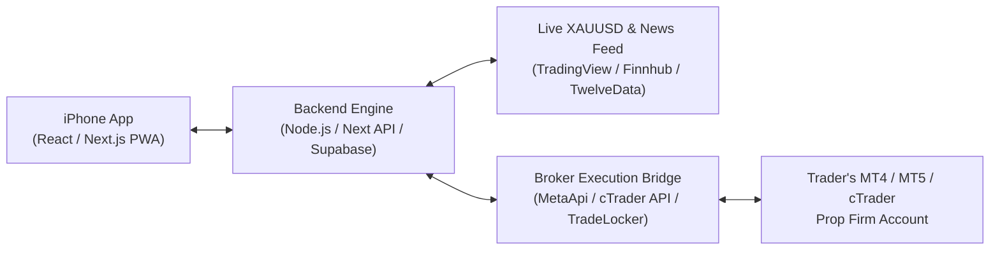

# 03. Technical Architecture & iPhone Testing Plan

## 1. Why Build as an iPhone-First Progressive Web App (PWA) + Capacitor/Expo Ready?

To test immediately on your iPhone **today** (without waiting 2 weeks for Apple App Store review) while keeping a native iOS feel:

1. **Instant iPhone Installation (PWA Home Screen App):**
   * Built with Next.js / React + Tailwind CSS configured with an **iOS Web App Manifest** (`apple-mobile-web-app-capable`).
   * When you open the local/cloud URL in Safari on your iPhone and tap **"Add to Home Screen"**, it installs with a custom app icon, launches **full-screen without browser bars**, respects the iPhone Dynamic Island / Notch (`safe-area-inset`), and supports smooth bottom-sheet gestures.
2. **Zero App Store Tax on SaaS Subscriptions:**
   * Selling \$39–\$69/month subscriptions via a Web/PWA app using Stripe means **you keep 100% of your revenue** (avoiding Apple's 30% In-App Purchase cut).
3. **1-Click Native App Store Packaging Later:**
   * The exact same React codebase can be wrapped with **Capacitor** or ported to **Expo (React Native)** when you want an official App Store listing.

---

## 2. iPhone Screen Architecture (4-Tab Bottom Navigation)

Designed specifically for **one-handed thumb operation** on iPhone:

1. **Tab 1: `⚡ Trade` (Execution & Calculator Pad)**
   * Select active Framework $\rightarrow$ Interactive Confluence Checklist toggles $\rightarrow$ Setup Grade Badge (`A+` / `Locked`).
   * Account Equity & `% Risk` selector (`0.25%`, `0.5%`, `1.0%`, `Custom`).
   * `XAUUSD` Entry / Stop Loss / Take Profit inputs with instant **Lot Size**, **Dollar Risk**, **Pip Distance**, and **R:R Ratio** output.
   * **Slide-to-Execute** bar (prevents accidental pocket taps) + Active Open Positions manager (`Close 50%`, `Move SL to BE`, `Flatten All`).
2. **Tab 2: `📋 Frameworks` (Configurable Playbook Builder)**
   * View, edit, or create new trading frameworks.
   * Add/remove checklist rules, toggle mandatory gatekeepers, set session restrictions, and set max risk per grade.
3. **Tab 3: `🛡️ Shield` (Prop Firm Rules & News Radar)**
   * Configure Prop Firm preset (`FTMO`, `FundingPips`, `Topstep`, `Custom`) with Account Size (\$10k – \$200k), Max Daily Loss %, and Max Overall Drawdown %.
   * Live Drawdown gauge + Consecutive Loss Tilt Lock settings.
   * Upcoming **USD / Gold Economic Calendar** with automatic lockout toggles.
4. **Tab 4: `📊 Journal` (Auto-Logged Trades & Edge Analytics)**
   * Equity curve, Win Rate by Framework, `A+` vs `B/C` Setup comparison, Session performance breakdown, and full trade history log.

---

## 3. System Architecture & Broker Integration Stack

### How Broker Connections Work in Production:
* **Phase 1 (MVP & Free/Pro Companion):**
  * Built-in **Live Paper-Trading & Instant Execution Simulator** synced with real-time `XAUUSD` prices + **1-Tap MT5/cTrader Copy Bridge** (calculates exact lots/levels, logs the trade in the journal, and lets the user paste into MT5 iOS in 1 second).
* **Phase 2 (Direct Cloud Execution for Prop Accounts):**
  * **MetaApi.cloud / cTrader Open API / TradeLocker REST API:** User enters their read/trade investor credentials once. When they slide "Execute" on their iPhone, your backend fires the market/limit order with hard SL/TP and partial take-profit orders directly to their broker server in `< 150ms`.

---

## 4. How We Will Test It on Your iPhone

Once we build the interactive app in this repository (`/Users/w4ss1m/Desktop/Trade`):

1. **Local Wi-Fi iPhone Testing (Instant):**
   * We run the dev server bound to your Mac's local network IP (e.g., `http://192.168.x.x:3000`) or via a secure tunnel (`npx untun` / `ngrok` / `cloudflared`).
   * You scan a QR code or open the link on your iPhone in Safari.
   * Tap **Share $\rightarrow$ Add to Home Screen** to test it as a full-screen native-feeling iPhone app.
2. **Interactive End-to-End Flows Ready to Test:**
   * Live `XAUUSD` price ticker & session detection.
   * Creating/customizing your own Gold trading framework & testing the **Unlock-to-Trade** checklist gatekeeper.
   * Testing the **Red-Folder USD News Lockout** (including a "Simulate CPI News in 5m" toggle so you can see the kill-switch in action on your iPhone).
   * Sizing a Gold trade, sliding to execute, managing partials (`Move to BE` / `Close 50%`), and watching the **Auto-Journal & Analytics** update immediately.

---

## 5. Development Roadmap

- [x] **Step 1: Market Research, Competitor Analysis & Product Spec** *(Completed in `/docs`)*
- [ ] **Step 2: Scaffold Mobile-First iPhone App in `/Users/w4ss1m/Desktop/Trade`**
  - Next.js / React + Tailwind CSS + Lucide Icons + PWA iOS Manifest + LocalStorage state persistence.
- [ ] **Step 3: Build the 4 Core Modules**
  - `⚡ Trade` Execution Pad & `XAUUSD` Lot Calculator with Slide-to-Execute.
  - `📋 Frameworks` Configurable Playbook Builder with Gold presets.
  - `🛡️ Shield` Prop Firm Drawdown Monitor & Live/Simulated USD News Kill-Switch.
  - `📊 Journal` Auto-Logger & Compliance Analytics Dashboard.
- [ ] **Step 4: Launch Local Server & Tunnel for Live iPhone Testing**
