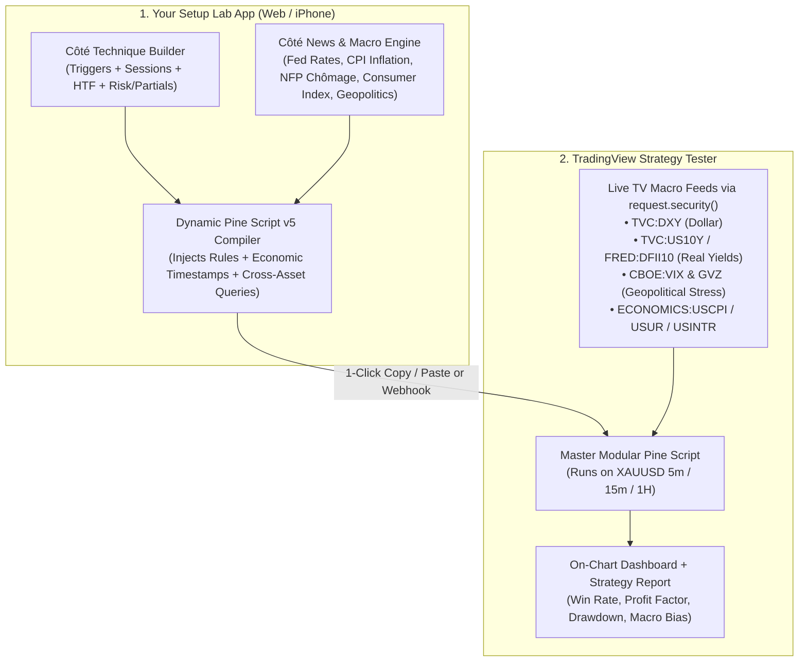

# 04. Complete System Blueprint: Dynamic Pine Script Generator & Macro/Geopolitical Gold Testing Engine

> **The Vision:** Technical setups alone fail when they fight Macro & Geopolitics. This system combines a **No-Code Visual Setup Builder (Côté Technique)** with a **Macro, Fed & Geopolitical Regime Engine (Côté Fondamental / News)** that compiles directly into a **Master TradingView Pine Script v5 Strategy**—letting you test any Gold (`XAUUSD`) setup across technicals AND macro regimes in 2 seconds.

---

## 1. System Architecture: How the Whole Ecosystem Works

---

## 2. Côté Technique: The Modular Setup Matrix

Every setup in your generator is broken down into **4 Lego Blocks** that you can mix, match, and test side-by-side:

### Block A: Entry Triggers (What gets you into the trade?)
1. **Setup 1 — Asian Session Liquidity Sweep + Reversal (ICT / SMC):**
   * Tracks the exact High and Low of the Asian Session (`20:00 – 02:00 EST`).
   * **Long Trigger:** Price sweeps below Asian Low (`low < asianLow`) and closes back inside the range with a bullish displacement candle.
   * **Short Trigger:** Price sweeps above Asian High (`high > asianHigh`) and closes back inside the range.
2. **Setup 2 — Fair Value Gap (FVG) + Market Structure Shift:**
   * Detects a 3-candle institutional imbalance (`FVG`) aligned with a Break of Structure (`BOS`).
   * Triggers entry when price retraces into the 50% equilibrium (`CE`) of the FVG.
3. **Setup 3 — London / NY Open Volatility Breakout (ORB):**
   * Defines the first 30 minutes of London (`03:00–03:30 EST`) or NY (`09:30–10:00 EST`) and enters on a momentum candle close outside the box with Volume > `1.5x` average.
4. **Setup 4 — Quantitative EMA 20/50 Pullback + RSI Divergence:**
   * Trend continuation setup when price pulls back to the 20 EMA while RSI shows hidden bullish/bearish divergence.

### Block B: Technical Filters (When is the setup allowed to fire?)
* **Killzone Session Filter:** Toggle independently:
  * `Asian (20:00–02:00 EST)`
  * `London Open (02:00–05:00 EST)`
  * `NY Open / Silver Bullet (08:00–11:30 EST)`
  * `London Close (10:00–12:00 EST)`
* **Higher Timeframe (HTF) Trend Filter:**
  * Require `1H` or `4H` price to be above `EMA 200` for Longs (and below for Shorts).
* **ATR Volatility Gate:**
  * Avoid dead markets (`ATR > Min Threshold`) and avoid blown-out news candles (`Candle Size < 2.5x ATR`).

### Block C: Dynamic Exit & Risk Engine
* **Stop Loss Mode:**
  * `Swing High/Low + Buffer` OR `ATR Multiplier (e.g., 1.5x ATR)` OR `Fixed Dollar/Pip Stop ($3.50 on Gold)`.
* **Take Profit & Partial Execution:**
  * **TP1 (Partial Exit):** Close `50%` of position at `1.0R` or `1.5R`.
  * **Auto-Breakeven:** Automatically move Stop Loss to Entry Price once `TP1` is hit.
  * **TP2 (Runner):** Close remaining `50%` at `2.0R`, `2.5R`, `3.0R`, or trail behind `EMA 20`.

---

## 3. Côté News, Macro & Géopolitique: How Gold (`XAUUSD`) Really Moves

Gold is not just a technical chart—it is the **inverse mirror of the US Dollar, Real Interest Rates, and Global Fear**.
Most traders don't realize that **TradingView has built-in Economic & Macro tickers** (`FRED`, `ECONOMICS`, `TVC`, `CBOE`) that our Pine Script generator can pull *automatically* using `request.security()` during a backtest!

### The 6 Macro & Geopolitical Pillars Built Into Our System:

| Macro Pillar | What It Means for Gold (`XAUUSD`) | TradingView Ticker Used in Backtest | Rule Applied to Your Setup |
| :--- | :--- | :--- | :--- |
| **1. La Fed & Taux d'Intérêt (Fed Rates & Real Yields)** | When US Treasury Yields (`US10Y`) and Real Yields (`TIPS`) drop, Gold explodes UP (because Gold pays 0% interest, so lower yields make Gold attractive). | `TVC:US10Y`, `TVC:US02Y`, `FRED:DFII10` | **Bullish Gold Filter:** `US10Y` is below its 20-EMA (falling yields). **Bearish Filter:** `US10Y` is rising. |
| **2. Force du Dollar US (`DXY`)** | Gold is priced in USD. When `DXY` dumps, `XAUUSD` rallies. | `TVC:DXY` | **SMT / Inverse Correlation Filter:** Only take Gold Longs if `DXY` is bearish on the 15m/1H chart. |
| **3. Inflation US (`CPI`, `Core PCE`, Breakevens)** | Rising inflation expectations (`T10YIE`) + dovish Fed = Rocket fuel for Gold. Hot CPI shock that forces Fed hikes = short-term Gold dump, then hedge rally. | `FRED:T10YIE` (10Y Inflation Expectations) + Injected CPI Release Timestamps | **Inflation Regime Filter:** Favors Longs when inflation expectations are expanding. |
| **4. Chômage & Emploi US (`NFP`, `Unemployment`, `Jobless Claims`)** | Rising unemployment (`Chômage` / `ICSA` Jobless Claims going up) forces the Fed to cut rates $\rightarrow$ **Ultra Bullish for Gold**. Strong NFP jobs $\rightarrow$ Bearish Gold. | `FRED:ICSA` (Initial Jobless Claims) + `ECONOMICS:USUR` + NFP 1st Friday Filter | **Labor Weakening Bias:** Boosts Long position size when Jobless Claims trend above 4-week SMA. |
| **5. Consumer Index (`Consumer Confidence` / `Michigan Sentiment`)** | Falling consumer confidence (`UMCSENT`) signals recession risk $\rightarrow$ Safe-haven inflows into Gold. | `FRED:UMCSENT` | Macro Regime Score component (+1 Bullish Gold when Consumer Sentiment weakens). |
| **6. Géopolitique & Panique Marché (Wars, Middle East, Central Bank Buying)** | Geopolitical escalations trigger immediate spikes in **Volatility (`VIX`)**, **Gold Volatility (`GVZ`)**, and **Oil (`USOIL`)** alongside safe-haven Gold buying. | `CBOE:GVZ` (Gold VIX), `CBOE:VIX`, `TVC:USOIL` | **Geopolitical Safe-Haven Mode:** When `VIX` or `GVZ` spikes above its upper Bollinger Band while Gold breaks structure upward, **disable Short setups** (never short Gold during a geopolitical crisis!). |

### Automated Red-Folder News Blackout (NFP / CPI / FOMC Filter)
Even a great setup gets destroyed by 50-pip slippage at **08:30 AM EST on CPI or NFP day** or **14:00 EST on FOMC day**.
Our system includes two layers of News Protection in the backtest:
1. **Algorithmic News Window Filter:**
   * Automatically detects **NFP Friday** (1st Friday of every month at `08:30 EST`) and **High-Impact 08:30 EST / 14:00 EST Windows** (or custom CPI/FOMC dates injected by the generator) and **blocks entries ±30 minutes around the release** (or optionally tests a *Post-News Liquidity Sweep* strategy 15 minutes *after* the print!).

---

## 4. The "Macro Composite Score" (-5 to +5)

Inside both the Web App and the TradingView Pine Script HUD, the system calculates a live **Gold Macro & Geopolitical Score** from **`-5` (Ultra Bearish Gold)** to **`+5` (Ultra Bullish Gold)**:

1. **`DXY` Trend:** `DXY < EMA` (**+1**) | `DXY > EMA` (**-1**)
2. **`US10Y` Treasury Yield Trend:** `US10Y` falling (**+1**) | rising (**-1**)
3. **Real Rates / Inflation (`FRED:DFII10` / `T10YIE`):** Real yields falling / Inflation expectations rising (**+1**) | rising real yields (**-1**)
4. **US Labor / Chômage (`FRED:ICSA` Jobless Claims):** Claims rising > 4-week average (**+1**) | falling (**-1**)
5. **Geopolitical Safe-Haven Flow (`CBOE:VIX` / `GVZ`):** Volatility elevated + Gold above HTF EMA (**+1 Safe Haven Bid**)

### How You Use This Score to Test Setups:
* **Test Mode 1 (Technical Only):** Run Setup A without macro filters. (e.g., *Win Rate: 51%, Profit Factor: 1.35*).
* **Test Mode 2 (Technical + Macro Aligned):** Toggle `[x] Require Macro Score >= +1 for Longs (and <= -1 for Shorts)`. Watch how filtering out trades that fight the Fed/DXY/Geopolitics boosts your **Win Rate to 68%+ and Profit Factor above 2.4**!
* **Test Mode 3 (Geopolitical Crisis Shield):** Toggle `[x] Block All Gold Shorts When Geopolitical Fear (VIX/GVZ) is High`.

---

## 5. Step-by-Step: How You Test Setups in Practice

1. **Open the Master Pine Script in TradingView** (saved in [`/pinescript/Gold_MultiSetup_Macro_Engine.pine`](../pinescript/Gold_MultiSetup_Macro_Engine.pine)) or generate a custom preset from our Web App.
2. **Open TradingView's "Strategy Tester" tab** on `XAUUSD` (`5m` or `15m` timeframe).
3. **Click the Gear Icon (Settings) on the Script** (or use our App's Visual Builder):
   * Switch **Active Setup** between:
     * `1. Asian Sweep + Displacement (SMC)`
     * `2. Fair Value Gap (FVG) Retracement`
     * `3. NY / London Session Opening Range Breakout`
     * `4. EMA 20/50 + RSI Momentum`
   * Toggle **Macro & News Filters**:
     * `[x] DXY Inverse Filter`
     * `[x] US10Y Yield Filter (Fed Proxy)`
     * `[x] Macro Economic Score Filter (Inflation + Chômage + Yields)`
     * `[x] Geopolitical Safe-Haven Shield (No Shorts in High VIX)`
     * `[x] Red-Folder News Blackout (Avoid 08:30 NFP/CPI & 14:00 FOMC)`
   * Adjust **Risk & Exits**:
     * Compare `1.5R` vs `2.5R` vs `3.0R` with `50% Partial at 1R + Breakeven`.
4. **Read the On-Chart Institutional Dashboard:**
   * Top-right table on your TradingView chart displays live:
     * Current Active Setup & Session Status
     * Live Macro Score (`DXY`, `US10Y`, `Inflation`, `Chômage`, `Geopolitics`)
     * Total Trades, **Win Rate %**, **Profit Factor**, **Net Return %**, and **Max Drawdown %**.
